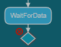

### Use a choice and junction to split transition flows

[Choices and junctions](https://secure-dev-ops.github.io/code-realtime/art-lang/#choice-and-junction) can be used for splitting an incoming transition into multiple outgoing transitions based on evaluating guard conditions.

* For a junction, the guards of outgoing transitions are evaluated before leaving the currently active state. Only if there is an outgoing transition from the junction with a guard that is `true` will the state machine leave the active state and transition via the junction to another state.
* For a choice, the guards of outgoing transitions are evaluated when reaching the choice. The outgoing transition with a guard that is `true` will execute next. **If there is no such transition, the state machine gets stuck in the choice pseudo state for ever.**

In this exercise you will use a choice and a junction to understand this important difference.

1. Start by opening the structure diagram of the <a class="open-file-link" href="Top.art">Top</a> capsule to understand the communication paths in the application. The `Top` capsule sends an `init` event to the `Sender` which makes it send a sequence of `data` events with numbers to the `Receiver`.

2. Look at the <a class="open-file-link" href="Sender.art">Sender</a> state machine to see the sequence of numbers that are sent to the `Receiver` with the `data` event. Your task is to complete the <a class="open-file-link" href="Receiver.art">Receiver</a> state machine so that it's able to detect 

    a) if the first received number is positive or not

    b) in case the first number was positive, if the second received number is positive or if it is negative

3. Create a choice `isPositive` and connect it with a transition from the `WaitForData` state. Let the transition trigger when the `data` event is received on the `com` port.

4. An error is reported for the choice in the Art file. Hover the error and make sure you understand it. If the setting [`code-rt.diagram.showDiagnostics`](https://secure-dev-ops.github.io/code-realtime/settings/#show-diagnostics-on-diagrams) is turned on, the error is also shown in the state diagram.

5. Create two outgoing transitions from the choice. Call the first `positive` and connect it to the `Positive` state. Write a guard condition for it that becomes `true` when the event data is a positive number. Call the second transition `else` and connect it to the `NotPositive` state. Write an `else` guard for it. 

_Note:_ A choice should always have an outgoing transition with an `else` guard (or with no guard which is equivalent). This ensures that the state machine won't get stuck in the choice.

6. Add effect code snippets for the two choice transitions which write a message to `stdout` ("Data is positive" or "Data is not positive").

7. Create a junction `check` and connect it with a transition from the `Positive` state. Let the transition trigger when the `data` event is received on the `com` port.

Note that no error is reported for a junction without outgoing transitions. The state machine will never trigger a transition that targets a junction unless there is a path of transitions with guards that are `true` that lead to another state. Since the junction currently has no outgoing transitions the state machine will stay in the `Positive` state.

8. Create two outgoing transitions from the junction. Connect the first to the `DoublePositive` state and write a guard condition for it that becomes `true` when the event data is a positive number. Connect the second transition to the `PositiveThenNegative` state and write a guard condition for it that becomes `true` when the event data is a negative number. 

Note that it's not necessary to have an outgoing transition with an `else` guard for a junction, since the state machine never can get stuck in a junction. However, you can of course create such a guard if you want.

9. Build and run the application and use the log messages to confirm that it successfully classifies the received numbers. After each pair of sent numbers the `Sender` sends the `reset` event which will make the `Receive` state machine go back to the `WaitForData` state so that it can receive two new numbers.
