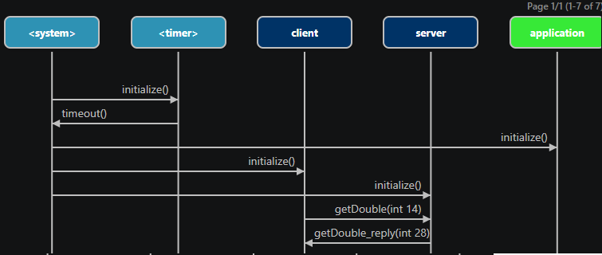
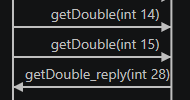
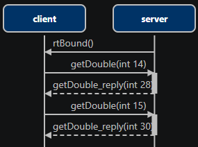

### Replace asynchronous communication (send) with synchronous communication (invoke)

Most communication in a realtime application is asynchrounous, i.e. a sender sends a message to a receiver without waiting for the message to be received. However, in some cases the sender may need to wait until the receiver has received and handled the message. A typical example is if the sender needs a reply with some data from the receiver. In this exercise a client asks a server to double a provided value. Your task is to change the application from using asynchronous communication, where the client has to wait in a state until the server sends the reply, to instead use synchronous communication. You can prepare for the exercise by reading this [section in the documentation](https://secure-dev-ops.github.io/code-realtime/target-rts/message-communication/#asynchronous-versus-synchronous-communication).

1. Open the state diagrams of the <a class="open-file-link" href="Client.art">Client</a> and <a class="open-file-link" href="Server.art">Server</a> capsules. The client sends the `getDouble` event to the server and then waits in the state `WaitForReply` until the server replies with `getDouble_reply`. Build and run the application to make sure it works as expected.

2. Capture a trace from the application by running it from a terminal like this:

```shell
./Top -URTS_DEBUG="trace on;quit"
```

3. Open the trace file `.trace.art-trace` that was saved next to the `Top` executable. Right-click in the trace file and perform the command **Open Sequence Diagram**. The trace is visualized as a [sequence diagram](https://secure-dev-ops.github.io/code-realtime/running-and-debugging/tracing/#view-traces-as-sequence-diagrams).



In the sequence diagram we can see all communication that takes place in the application. 

4. Update the client so it sends another `getDouble` event, with 15 as data, right after the first one.

5. Build the application and run it again from the terminal to capture a trace. In the updated sequence diagram we can see that both `getDouble` events are sent before the reply is received from the server. This shows that the communication is asynchronous.



6. Now change the client and server to use synchronous communication instead. The client needs to call `invoke()` instead of `send()`, and the server needs to call `reply()` instead of `send()`.

7. It's not advisable to use synchronous communication from the initial transition of the client since it may execute before the server is fully initialized and has reached its `Ready` state where it's ready to make the reply. Rename the state `WaitForReply` to `WaitForBound` and create a new transition from `WaitForBound` to `Done`. Move the `invoke()` calls to this transition instead of the initial transition and print the replies to `stdout`:

```cpp
Log::out << "Got reply 1: " << *static_cast<int*>(reply1.data) << Log::endl;
Log::out << "Got reply 2: " << *static_cast<int*>(reply2.data) << Log::endl;
```

`reply1` and `reply2` should be local variables typed by [RTMessage](https://secure-dev-ops.github.io/code-realtime/targetrts-api/class_r_t_message.html).

8. Let the new transition from `WaitForBound` to `Done` trigger when the predefined event `rtBound` is received on the `serverP` port. You need to make `serverP` a [notifying port](https://secure-dev-ops.github.io/code-realtime/art-lang/#notifying-port) for this event to arrive.

9. Build the application and run it again from the terminal to capture a trace. In the updated sequence diagram we can see that the message communcation between the client and the server now is [synchronous](https://secure-dev-ops.github.io/code-realtime/running-and-debugging/tracing/#synchronous-communication).

