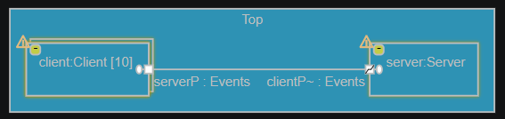
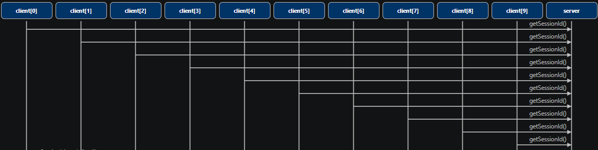

### Extend the application to let 10 clients connect to the server

Both ports and parts can have a multiplicity. In a previous exercise you already learnt that the [part multiplicity](https://secure-dev-ops.github.io/code-realtime/art-lang/#part) specifies how many capsule instances the part can contain at run-time. Similarly, the [port multiplicity](https://secure-dev-ops.github.io/code-realtime/art-lang/#port-multiplicity) specifies how many connections to other ports that can be established at run-time from that port. In this exercise you will learn how the multiplicities of ports and parts interplay with each other.

1. Open the structure diagram of the <a class="open-file-link" href="Top.art">Top</a> capsule. A single client is connected to a server, and can request a session id by sending and receiving the events defined in the <a class="open-file-link" href="Events.art">Events</a> protocol. The client uses a [notifying port](https://secure-dev-ops.github.io/code-realtime/art-lang/#notifying-port) to get notified with the `rtBound` event when the connection to the server has been established.

2. Build and run the application. 

3. Increase the multiplicity of the `client` part in <a class="open-file-link" href="Top.art">Top</a> to 10. Note that this leads to warnings both for the `client` and the `server` ports. If the setting [Show Diagnostics on Diagrams](https://secure-dev-ops.github.io/code-realtime/settings/#show-diagnostics-on-diagrams) is turned on, the warnings also appear on the structure diagram of `Top`.



4. The warnings show there now is an inconsistency in the multiplicity of the `client` part and the multiplicity of the `clientP` port of the <a class="open-file-link" href="Server.art">Server</a> capsule. If you build and run the application you will get the same result as before. This is because while there now are 10 clients, only one of them can be connected to the server because the multiplicity of the `clientP` port is only 1. Fix the problem by setting the multiplicity 10 for the `clientP` port of <a class="open-file-link" href="Server.art">Server</a>.

5. Build and run the application. Now all 10 clients are connected to the server, but there are two problems in the application that can be seen from the log printouts:

    - All clients get the same session id (0).

    - Each client receives more than one message for the `getSessionId_reply` event.

6. Fix the first problem by adding a member variable `nextClientNumber` to the <a class="open-file-link" href="Server.art">Server</a> capsule. Initialize it to 1 and increment it by 1 each time the `getSessionId_reply` event is sent to a client.

7. The second problem is caused by the use of `send()` to send the `getSessionId_reply` event on the `clientP` port. Since this port now has a multiplicity of 10, `send()` will send the event to all 10 connected clients each time. Change the server to instead use the `sendAt()` function which takes a port index as argument, so the event only will be sent to the client that is connected on that port index. Obtain the port index to send at from the `msg` object like this:

```cpp
sendAt(msg->sapIndex0())
```

8. Again build and run the application. Make sure there are no run-time errors and that each client receives a unique session id. Capture a trace and show it as a sequence diagram. Note that each client capsule instance has its own lifeline.


