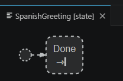
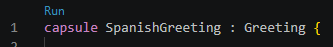
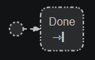

### Use capsule inheritance to customize the state machine of a capsule

A capsule can [inherit](https://secure-dev-ops.github.io/code-realtime/art-lang/#capsule-inheritance) another capsule. The state machine of the derived capsule then inherits the state machine of the base capsule. The derived capsule can customize the inherited state machine, for example by redefining a transition or a state. In this exercise you will use capsule inheritance for customizing the behavior of an application that prints a greeting.

1. Build and run the application. Note that "Hello World!" is printed to `stdout` by the <a class="open-file-link" href="Greeting.art">Greeting</a> capsule.

2. Create a new capsule `SpanishGreeting` which inherits from `Greeting`. Place it in a new file `SpanishGreeting.art`.

3. If you created the `SpanishGreeting` capsule with the **New Capsule** command from the `ctrl+space` menu it now has two initial transitions; one locally defined in `SpanishGreeting` and one that is inherited from `Greeting`. This is reported as an error [ART\_0008_initialTransitionCount](https://secure-dev-ops.github.io/code-realtime/validation/#art_0008_initialtransitioncount). Fix the problem by removing the initial transition from `SpanishGreeting`. You can also remove the state since it's not needed.

4. Open the state diagram of `SpanishGreeting`. The contents of `Greeting`'s state machine is drawn using a dashed outline to show that the initial transition and the state is inherited.



5. Redefine the `Done` state in the state machine of `SpanishGreeting` and change the entry action so it prints "Hola Mundo!" instead.

6. To test the new capsule click the **Run** link that appears above it.



This command creates a temporary TC with `SpanishGreeting` as the top capsule, builds and runs it. It's useful for quick testing of "self-contained" capsules like this one.

7. Look in the state diagram of `SpanishGreeting`. Note that the `Done` state now is drawn with a "dash-dot-dot" outline to show that it is redefined.



8. Make the `greeting` part of the <a class="open-file-link" href="Top.art">Top</a> capsule optional. Also add a frame port and write code in the initial transition that incarnates `greeting`:

```cpp
RTActorId aid = frame.incarnate(greeting, RTType_SpanishGreeting);
if (!aid.isValid()) {
    Log::out << "Failed to incarnate SpanishGreeting" << Log::endl; 
}
```

The second argument to the `incarnate()` call is the type descriptor of the `SpanishGreeting` capsule. Without this argument the TargetRTS would create an instance of `Greeting` instead, since that is the type of the `greeting` part.

9. Build the application and fix any compilation errors. Run the application and make sure the Spanish greeting is printed.
